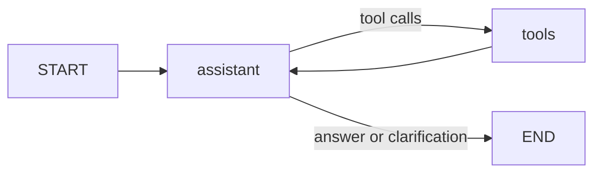

# LangGraph Weather Search Agent

## Web interface

Install the updated requirements, then start the web app from this folder:

```powershell
.venv\Scripts\python -m pip install -r requirements.txt
.venv\Scripts\python -m uvicorn web_app:app --host 127.0.0.1 --port 8000
```

Open http://localhost:8000. The web app uses the same `build_agent()` as the CLI.
Your `.env` stays on the server and is never served to browsers. Chats are held
in server memory, expire after one hour of inactivity, and reset on restart.
Each chat permits 20 questions; New chat resets the conversation. Run one worker
because sessions are in memory. Refreshing the page clears visible chat bubbles
but retains the server conversation until New chat or session expiry.

### Deploy to Render

1. Put the contents of this `weather-agent` folder in a GitHub repository.
   Keep `.env`, `.venv` and `__pycache__` out of Git (already ignored).
2. Sign in at https://dashboard.render.com and create a **Blueprint** from that repository.
   Render reads the included `render.yaml`.
3. Set `OPENAI_API_KEY` in Render's environment settings and choose a strong
   `APP_PASSWORD`. Do not include either secret in your repository.
4. Deploy. Open the assigned HTTPS URL and sign in with username `weather`
   and your `APP_PASSWORD`.

The included configuration requests Render's free plan; verify availability in
your account. Free services can sleep when idle, so the first request may be slow.
AI requests use your API account. The shared password is intended for a personal
app; set provider spending limits. The server limits concurrent requests and
paces each session, but this is not a multi-user billing or abuse-control system.
For a manually created Web Service, use `pip install -r requirements.txt` as the
build command and `uvicorn web_app:app --host 0.0.0.0 --port $PORT --workers 1`
as the start command. Use `/healthz` as the health check path.

[Render's FastAPI deployment guide](https://render.com/docs/deploy-fastapi)


A Python agent that selects tools to search cities and retrieve current weather
and forecasts from Open-Meteo. Includes interactive conversation history,
Celsius/Fahrenheit, location clarification and bounded network requests.

## Setup (Python 3.10+)

From this folder on Windows PowerShell:

```powershell
python -m venv .venv
.venv\Scripts\python -m pip install -r requirements.txt
Copy-Item .env.example .env
```

Edit `.env` and set your `OPENAI_API_KEY`. Set `OPENAI_MODEL` to a tool-calling
model available in your account if needed. Model calls may incur charges.
Do not commit `.env` or share your API key.

```powershell
.venv\Scripts\python weather_agent.py "What is the weather in Mumbai, India tomorrow?"
.venv\Scripts\python weather_agent.py
```

On macOS/Linux use `python3` and `.venv/bin/python`; copy the environment example
with `cp .env.example .env`.

Example chat: `Weather in Paris, France?`, then `And tomorrow in Fahrenheit?`.
History lasts for the current process only. Type `exit` to quit.

## Graph



`search_locations` returns candidate places. `get_weather` fetches coordinates
selected by the agent. `MessagesState` accumulates model, user and tool messages;
conditional routing repeats until the model answers. A recursion limit prevents
unbounded tool loops. Tests inject a scripted model so no paid model call is needed.

## Tests

```powershell
.venv\Scripts\python -m unittest discover -s tests -v
```

## Limits and references

Forecasts cover up to seven days including today; historical weather is unsupported.
Current conditions are weather model estimates, not direct station observations.
Location selection and natural-language interpretation depend on the model.
Open-Meteo's public endpoint needs no weather API key for noncommercial usage;
check its terms and commercial plans before commercial deployment.

- [LangGraph quickstart](https://docs.langchain.com/oss/python/langgraph/quickstart)
- [Open-Meteo forecast API](https://open-meteo.com/en/docs)
- [Open-Meteo geocoding API](https://open-meteo.com/en/docs/geocoding-api)
- [Open-Meteo terms](https://open-meteo.com/en/terms)
